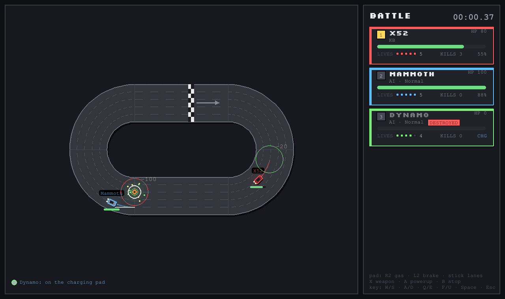
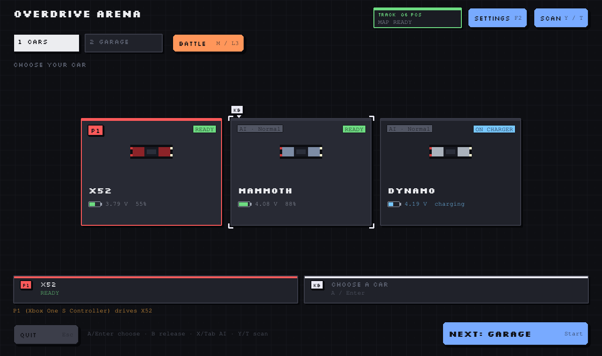
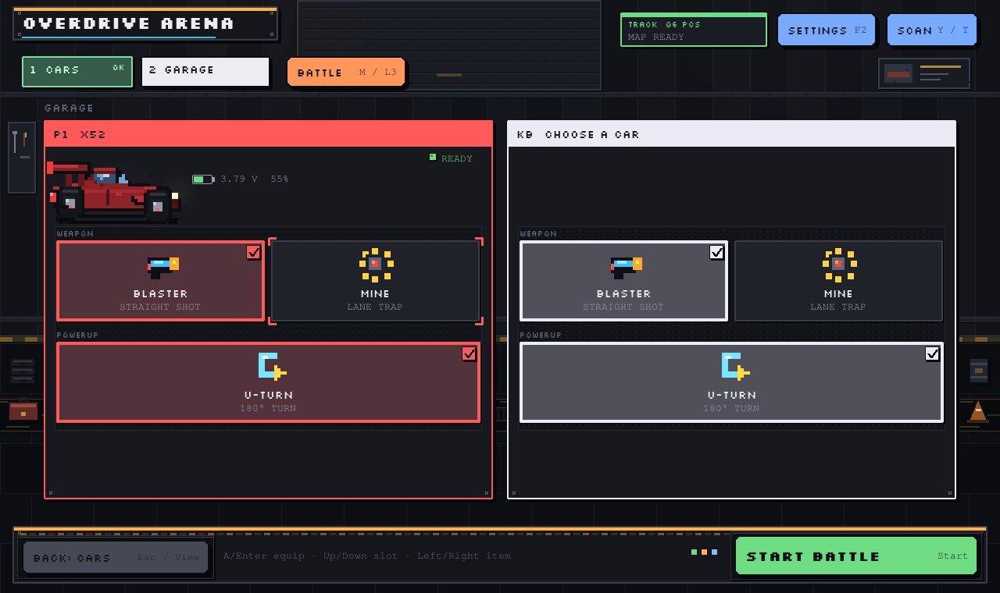
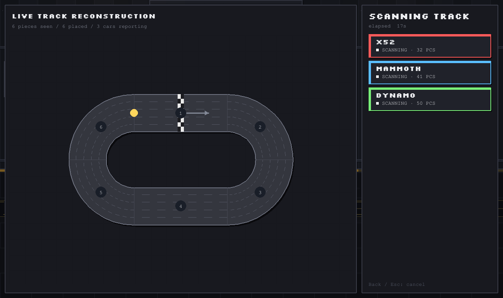
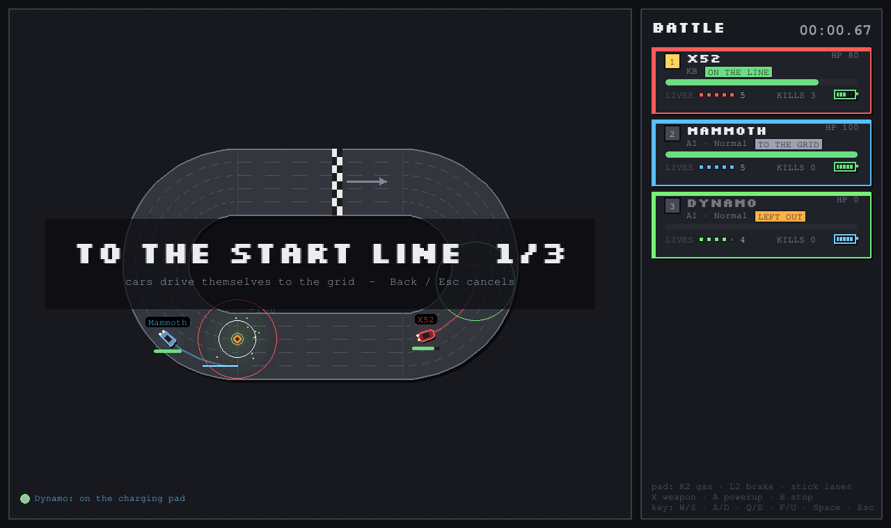
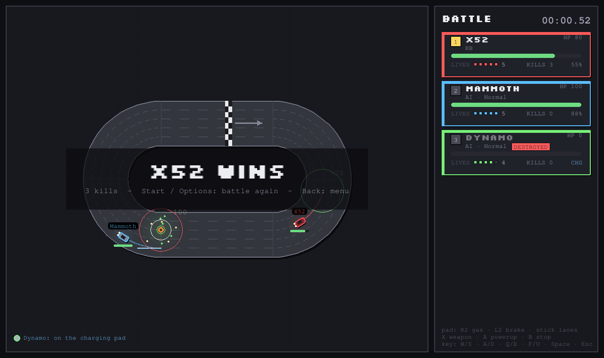

# Overdrive Arena

Drive [Anki Overdrive](https://en.wikipedia.org/wiki/Anki_(company)) cars from a Windows PC with Xbox / PS5
controllers or the keyboard, watch them live on a map scanned from your own track, and race or battle with
virtual weapons. Pure Python: `bleak` for Bluetooth LE, `pygame` for input and rendering.

The cars are long out of production and the official app is gone from the stores. This project talks to the
cars directly, with the protocol verified on real hardware (firmware 11866) and documented below.



| Lobby | Garage |
|---|---|
|  |  |

| Track scan | Starting grid |
|---|---|
|  |  |



## Features

- **Controllers**: any gamepad SDL recognises (Xbox, DualSense, Switch Pro...) plus the keyboard, one per car.
  Pads can join or leave while the app runs.
- **Starting grid**: every participating car keeps retrying until it stops on the start-line bar. The car
  brakes itself on the bar via a firmware command, so the stop does not depend on Bluetooth latency.
  Lost position triggers slow recovery bursts with pauses; missed starts and link loss do not
  exclude a car. A car still on its charger when the grid forms is left out of that race. Cars line up in
  separate lanes, then wait on the line until Start / Options / Space is
  pressed again. The 3-2-1-GO countdown then launches every car at a 400 mm/s start speed (capped by the
  race and personal limits), so players do not need to accelerate from a standstill. To leave a car out,
  return to the lobby with Back / Esc and set it to parked.
- **Race speed**: open Settings (gear / F2 / LT + left-stick click) to cycle the shared ceiling from 200
  to 2000 mm/s. It caps players, AI and boosts; individual lower limits still apply. At race finish only
  the winning car remains illuminated until returning to the lobby.
  The winner's RGB celebrates with 12 slow blinks over 12 seconds; losing players get a 1.2-second
  controller vibration. Results remain visible for 14 seconds (Start / Options can begin a rematch sooner).
- **Fair Game**: toggle FAIR in Settings, press H, or hold LT and click the right stick. During a race,
  first place loses 20 mm/s and second loses 10 mm/s from the commanded speed; later places lose none.
  Penalties follow live positions, apply to players and AI. Parked cars are excluded and solo runs have
  no penalty.
- **Player lights**: each player keeps one colour across the lobby badge, car card and roof LED. The roof is steady while healthy and blinks faster as battle HP drops; the front lights flash red/green when firing, the tail flashes red when hit, and a destroyed car goes dark. Battery warnings stay on screen, not on the car.
- **Cooperative track scanning**: cars share compatible lap observations and wheel measurements to fill
  missing codes and turns. Code changes also recover missed transition messages. A live reconstruction
  replaces the saved map while scanning, with unresolved gaps marked `?`. Scan speed cycles through
  450, 500 and 400 mm/s on retries; cars losing track codes stop independently. Only a complete,
  geometrically closed loop replaces `track.json`.
- **Live map**: a circuit-constrained Kalman position estimate combines measured speed, lane radius and BLE
  position fixes. The display mirrors the engine exactly; the engine dead-reckons from the latest
  code/bar for weapons and AI and extrapolates for up to three seconds without a fix. Track codes are
  treated as zones, not exact points: a prediction inside the code's zone is kept, only a prediction
  outside it is corrected to the nearest zone edge. Transition bars remain exact anchors.
- **Two modes**: BATTLE (one weapon + one powerup per player, 5 lives, last car wins) or RACE
  (laps only, powerups only, first to N laps wins).
- **Lobby and garage**: a two-step setup wizard in a pixel-art workshop. Step 1 chooses cars in
  parking bays with player-coloured ownership, 3/4 hero sprites and ready lamps; step 2 gives every
  player their own workbench panel to configure a weapon and powerup at the same time. Silkscreen
  headings, chunky buttons, a structured pit-lane floor and a control-console deck keep the UI dense
  but readable.
- **AI drivers** with per-car Easy, Normal, Hard, and Extreme levels, including AI-only races. They brake before curves and accelerate on straights.
- **Battery and charger tracking**: voltage, estimated %, sag under load (finds tired cells), CHARGING /
  CHARGED when a car sits on its pad, CSV history.
- **Robust links**: automatic reconnection when a car reboots, gentle default acceleration for old batteries.

## Setup

Windows 10/11 with a Bluetooth LE adapter, Python 3.11+.

```bash
git clone https://github.com/Leicas/overdrive-arena.git
cd overdrive-arena
python -m venv .venv
.venv\Scripts\python -m pip install -r requirements.txt
.venv\Scripts\python app.py
```

Cars must be powered on. Turn controllers on before starting (or later, they hot-plug).
Gamepads continue working when the window loses focus; keyboard controls require focus.
Controllers pulse on **3, 2, 1**, with a stronger pulse at **GO**.

## How to play

1. **Connect**: every advertising car is connected (limit with `--max-cars N` or `--car <address>`).
2. **CARS**: one card per car with a clear player-coloured owner badge (`P1`, `P2`, `KB`), **AI** or
   **PARKED**. Every controller and the keyboard has its own cursor badge.
   - Move the cursor: D-pad / left stick (keyboard: Left/Right). The car under a cursor blinks its headlights.
   - **A** (Enter): take the car you are hovering. Press again, or **B** (Backspace), to release it.
   - **X** (Tab): cycle an unclaimed car through Easy / Normal / Hard / Extreme / Parked (default: Normal).
   - **SCAN TRACK** (Y / T / click): cars combine compatible readings to reconstruct the circuit together.
     Watch the new map grow during scanning. Cars with no codes for 8 s, or lost codes for 3.5 s, stop
     independently; other cars continue. Only a complete closed loop replaces the saved map.
   - **SETTINGS** (gear / F2 / LT + left-stick click): shared speed ceiling and Fair Game.
   - **BATTLE / RACE** (M / left-stick click / click) picks the mode; **D-pad up/down** or the **laps**
     button selects 3 / 5 / 10 / 20 laps.
   - **NEXT: GARAGE** (Start / Options / Space / click): enabled with at least one connected player or AI
     car off its charger. This does not start the race yet.
3. **GARAGE**: every player gets their own panel and configures a weapon and powerup at the same time.
   Battle shows `WEAPON` + `POWERUP`; Race shows `POWERUP` only.
   - **A / Enter**: equip the hovered item.
   - **D-pad up/down**: switch between weapon and powerup.
   - **D-pad left/right**: choose an item.
   - **Back / Esc / View**: return to CARS.
   - **START BATTLE / RACE** (Start / Options / Space / click): starts the race.
4. **Starting grid**: each participant drives to the start line in its own lane (turning around first if it
   faces the wrong way), crawls the last piece at 300 mm/s and asks the car's firmware to brake itself on
   the start-line bar. Because the car stops on the shared bar event, every car lines up at the same
   physical point without the Bluetooth round-trip. Cars that overshoot the bar do a full lap at 500 mm/s
   before trying again, and a car may settle in another free lane instead of repeating a lane change.
   Missing position triggers repeated 1.5-second recovery bursts with 2-second pauses. Disconnected cars
   remain pending. Cars still on their charger when the grid forms are left out of that race instead of
   blocking the start; take such a car off the charger before starting and it joins the next race. Parked
   cars are left out as before. The countdown waits only for the remaining grid participants.
   Once the field is on the line, press **Start / Options / Space** again to begin the 3-2-1-GO countdown.
   At GO every participant receives a 400 mm/s launch target, so cars move immediately; throttle still
   raises the player's held speed afterwards.
5. **Race**. **Back** (Esc) stops everything and returns to the lobby. **F11** toggles fullscreen.
   After a finish, **Start / Options** starts another grid and countdown with the same selections.
   Put an off-track car back on the track and nudge it; it resumes automatically as soon as it reads a
   track transition. No recovery button or key press is needed. Recovery invalidates the current lap.

BLE notifications are timestamped on arrival, before parsing or queueing. Position fixes are applied at
that time and projected to the current frame; older out-of-order motion updates are ignored. The map
draws exactly the engine position, including a backward correction when the estimator re-anchors; it
does not hide estimator changes behind a separate monotonic display. A 30 ms measurement lead
compensates the BLE hop; the firmware's position packet has no device timestamp, so this is a calibrated
approximation.

The lap counter uses one continuous, unwrapped route estimate. Every update and frame prediction is kept
in timestamp order, so a forward circuit completes a lap even if the finish codes were missed or several
updates arrived between frames. Crossing times are interpolated along the track geometry. The lap counter
cannot subtract distance already counted or count a finish twice. Prediction freezes after one second
without a fix; silence holds lap progress instead of erasing it or inventing more laps. Reversal, explicit
off-track reports and recovery reset the partial lap. The HUD shows current-lap progress; reset reasons
are written to the log. A complete forward circuit is required for a timed lap.

The engine prediction horizon can be tuned with `ARENA_ENGINE_HORIZON` (seconds, default 3); the code-zone
phase (default 0.05) with `ARENA_CODE_SLOT_BIAS`. The map has no separate smoothing or render lead: it
shows the engine state directly.

| Action              | Xbox            | PS5           | Keyboard          |
|---------------------|-----------------|---------------|-------------------|
| Accelerate / decelerate | RT / LT     | R2 / L2       | W / S             |
| Steer / lane change | Left stick X    | Left stick X  | A / D             |
| Snap lane           | LB / RB, D-pad  | L1 / R1       | Q / E             |
| Fire weapon (hold for Blaster) | X     | Square        | F                 |
| Powerup (hold or tap) | A             | Cross         | U                 |
| Straight boost      | Left stick click | L3           | Left Shift        |
| Emergency stop      | B               | Circle        | Space             |
| Speed limit +/- 100 | D-pad up/down   | D-pad up/down | + / -             |
| Next / start        | Start / Options | Options       | Space             |
| Settings            | LT + Left stick click | L2 + L3 | F2                |
| Back / quit         | View            | Share         | Esc               |
| Garage -> CARS      | View            | Share         | Esc               |

### Speed and boost

Player speed is a **held target**: RT/R2 (or W) raises it, LT/L2 (or S) lowers it, and releasing the
input keeps the current speed, like the slider in the official app. Analog trigger travel scales how
fast the target changes. D-pad up/down or +/- changes the player's ceiling by 100 mm/s; the target is
clamped to that ceiling and the shared race limit. The limit is retained when you release/reclaim a
car and does not raise its AI limit. Actual motor speed may be lower. `--player-max-speed` sets a lower
initial limit; `--max-speed` sets the AI limit.

The player ramp uses **450 mm/s²** acceleration and **900 mm/s²** braking. While moving, the target
never drops below **300 mm/s**; this prevents the stutter and lost track codes at crawling speed.
**B** remains the immediate emergency stop. Speed writes are capped at **5 Hz**; the firmware interpolates
between targets with the commanded acceleration. Larger host steps therefore still feel smooth, while the
car keeps more BLE connection events for position notifications. Releasing the trigger sends one exact
hold target immediately; constant speed sends nothing.

Steering uses the four physical lane centers. A stick push changes one lane (LB/RB also snap one
lane). Between track codes the localizer follows the car's own 0x41 current/target offsets, so it does
not wait for the next code; the next code remains authoritative and corrects the estimate.

**Left-stick click / Left Shift** requests a 0.6-second straight boost, with a 6-second cooldown.
Hard and Extreme AI use it automatically when possible. The boost ceiling is 150% of the normal limit,
capped at 1500 mm/s, and braking-distance checks may lower the target. Boost does not raise curve or
learned corner limits and cancels for curves, stale position data, recovery, lane changes, or nearby
traffic. A player already using the full 2000 command range needs no boost.

### Battle weapons and lives

- In the `GARAGE` step every player equips **one weapon** and **one powerup**. Weapons are
  **Sniper**, **Blaster** and **Mine**; powerups are **U-turn**, **Hook**, **Anchor** and **Booster**.
- **Sniper** (2 s cooldown): fires straight from the car's nose in its current heading, as far as the
  track surface continues. Only the nearest car in the same lane is hit; other lanes and cars around a
  corner are not. 34 damage, no energy pool.
- **Blaster** (hold X): short-range spread weapon, 500 mm. Every car in the cone is hit, including the
  adjacent lanes; 3 damage per pulse at 5 pulses/s. Holding for 4 s empties the weapon and forces a
  2.5 s overheat. A short tap only uses part of the energy. At 0 the blaster cannot fire until it has
  recharged to 20 %. Weapon energy is separate from powerup energy.
- **Mine** (4 s cooldown, 2 active): dropped in your lane, arms after 1 s, lives 45 s. A car passing
  within 12 cm in that lane takes 35 damage. Mines cost HP only and do not stop the car.
- **U-turn** (hold A): starts at 50 % powerup energy. 100 energy drains in 3.5 s, so a full bar gives the
  full 3.5 s; 50 % gives 1.75 s. Releasing or running empty flips the car forward again. Reverse speed is
  capped at 500 mm/s and the weapon stays enabled. Lap progress is invalidated.
- **Hook** (hold A): tethers the nearest car ahead in any lane within 1000 mm (breaks beyond 1200 mm).
  The victim's commanded speed is reduced to 75 %, never below 300 mm/s. Full energy lasts 5 s. The
  attacker gets yellow front lights; the victim gets a slow red tail pattern and a visible cable.
- **Anchor** (press A): stops the car for 2.5 s and costs 50 powerup energy. The car remains vulnerable
  and can still fire. Useful to let an opponent pass, avoid a mine or block a lane briefly.
- **Booster** (hold A): raises the target to 160 % of the personal limit, capped at 2000 mm/s. Full energy
  lasts 2.5 s. It uses the same safety checks as the short straight boost and does not stack with it.
- AI cars pick one weapon and one powerup at random for each battle and obey the same energy rules.
- Each car starts with **5 lives**. 100 HP per life. At 0 HP the car is destroyed: stopped 3 s with all
  lights off, then respawns and loses one life. At 0 lives it is eliminated; the last car with lives
  remaining wins the battle. Kills are counted.
- Only destruction stops a car; ordinary hits never slow it down.
- Hits flash the victim's tail lights red and rumble its controller; a destroyed car gives a clearly stronger,
  longer vibration. The shooter's front lights alternate red/green while firing. A destroyed car stays dark
  until it respawns; an eliminated car stays dark for the rest of the battle.
- The race HUD deliberately omits speed, lane, weapon cooldown, powerup energy meters, last lap and the
  event log. Battle cards show HP, remaining lives and kills; race cards show lap progress and battery.

### Car light language

- **Roof**: the player's colour. Battle only: steady above 60 HP, slow blink at 1 Hz up to 60 HP, fast
  blink at 3 Hz up to 20 HP, off at 0 HP. The countdown blinks the roof in the player colour.
- **Front**: off, except for the red/green weapon flash when firing (the original app's shooting mode).
- **Tail**: off, except for a red flash when hit. A blaster hit is a short flash; a mine hit is a longer,
  heavier throb.
- **Destroyed**: every light is off for the 3-second stop. Respawn returns the roof to the steady player
  colour.
- Player colours are per driver, not per car: claiming a different car moves the colour with the driver.
  Unclaimed AI/parked cars take a free colour so two cars never share a roof colour.

### Race mode

Weapons off; only the powerup slot is shown in the garage and used on the track. Cards show
`LAP n / target` and a progress bar; ranking by laps then position. The first car to the target gets a
"X WINS" banner, the others roll to a stop, and the app returns to the lobby. `--mode race --laps 10`
pre-selects.

By default, AI straight / curve targets are 64% / 52% (Easy), 80% / 68% (Normal), and
100% / 84% (Hard) of the car speed limit. Hard uses the full limit on straights with enough braking room.
An explicit `--ai-speed` overrides the Normal straight baseline; Easy uses 80% and Hard 125% of it,
always capped by the car speed limit. Actual speed depends on acceleration and available straight length. Hard AI also reacts faster with weapons in Battle.
Unknown positions use a cautious speed up to 300 mm/s. Hard brakes later for turns. In Race mode, AI checks cars ahead and behind before passing into an adjacent lane, reserves pending lane changes, and slows behind traffic when blocked. Lane changes start only on straights. The AI looks three pieces ahead and prefers the shortest clear lane through upcoming curves, moving one adjacent lane at a time. Balanced left/right turns keep the current lane to avoid needless weaving.

**Extreme** automatically uses a ceiling of **2,000 mm/s**; an explicit `--max-speed` overrides it.
It chooses the actual target from the current lane, requested lane, and braking distance to upcoming
curves, with an 80 ms braking margin. Corner speed starts from the tighter lane radius
(`v = sqrt(3200 * radius_mm)`). Short straights may never allow the full ceiling before braking.
This is a tunable driving model, not a measured grip guarantee for every car and track.

AI learns a corner-speed limit separately for each car. A spin or confirmed off-track event near a
curve lowers that limit by 15% (minimum 200 mm/s); retries during the same recovery do not lower it
again. Extreme scales this learned limit with curve radius: tighter lanes need lower speeds, while
wider curves can be faster. The lower corner limit also brings braking forward on the approach.
After three fully observed clean turns at at least 90% of the learned limit, AI probes 2% faster,
bounded by the difficulty's normal limit and, for Extreme, the geometry estimate. Slow traffic does
not earn a speed increase. Adjustments are written to the log; the race HUD stays minimal.
Learning stays in memory across races; restarting the app or loading/scanning a track resets it.

A reversal invalidates the current lap. The next forward finish-line crossing starts a fresh timed
lap; it earns no point. A complete forward circuit is required to score again, so U-turns, finish-line
oscillation, and lost localization cannot create a shortcut lap. Already completed laps are retained.

### Off-track recovery

An explicit off-track report stops that car immediately. If track messages go stale instead,
it tries reading the track at 300 mm/s for at most 1.5 seconds, then stops. There are no endless retries.
Put a stopped car back on the track and nudge it: the car then reports a transition event, which clears the
waiting state, and driving resumes automatically. No recovery button or key press is needed. Player cars
roll away at the 400 mm/s start speed; hold the brake or press stop to cancel that. A car that
respawns after being destroyed gets that bounded search automatically, because its 3-second stop makes
the previous track codes stale. Wrong-way recovery still applies.
Cars on chargers or with lost connections do not search. Recovery invalidates the current lap.
Leaving a curve and reporting off-track also lowers the learned corner limit once per incident, including a report that arrives after a search has begun or between rendered frames. Missing telemetry alone does not count as a cornering failure.

### What the screen shows

- **Map**: car sprites with trails, hit rings, explosions, floating damage; mines pulse once armed; hook
  cables link attacker and victim; cars that are off the track, on a charger or have lost their link are
  listed in the map corner.
- **Cards**: rank badge, car name, short driver label, status chip (LINING UP / ON THE LINE /
  ELIMINATED / DESTROYED / WRONG WAY / OFF TRACK / ON CHARGER / OVERHEAT / BOOSTER / ANCHOR /
  TURNING / REVERSING), HP + lives + kills in battle, lap progress in race, and a compact battery icon.
  Speed, lane, weapon cooldown, powerup energy meters, last lap and the event log are deliberately omitted.
- **Map/clock**: car sprites, trails, hit rings, explosions, floating damage, armed mines, and the
  off-track/charger list in the corner. The race clock stays in the panel header.

### Position and Bluetooth diagnostics

The race HUD no longer shows **P** (position age) and **BT** (notification age) so the cards stay
minimal. Use `-v` to log AI position/radio telemetry and notification-to-game processing delay
(`queue_delay`) when diagnosing a weak link; player cars use the same message path. During motion, a
fresh BT age with an old P age points toward missing track readings/localization; both old means no
notifications have arrived recently, but does not by itself prove radio interference. Stationary cars
naturally report fewer track codes.

Bluetooth callbacks enqueue messages; the game thread applies localization, battery logging, and
scanner updates in order using the original reception timestamps. This keeps disk I/O out of the BLE
loop and prevents rendering/driving from seeing half-applied positions. Startup connects cars serially.
Unknown track locations no longer masquerade as fresh position fixes; a forward/backward code wrap
between identical adjacent pieces can repair a missed transition.

The map interpolates between discrete printed track codes; it is not a continuous physical-position
sensor. These changes improve software handling, but do not establish that every gap is software-caused.
For comparison tests, use charged cars and wired controllers, and compare one car with three on the same
track. Earlier hardware trials showed weaker links with Bluetooth controllers sharing the adapter and
battery voltage sag under acceleration.

### Battery and charger

The car reports its single-cell LiPo voltage (polled every 4 s) and a status word with on-track / on-charger /
battery-low / battery-charged flags. The lobby and garage show voltage, an estimated percentage from a
resting-voltage curve, and the **sag** between idle and under-load voltage: above 0.20 V the cell is tired
(`WEAK CELL`) and that car is the one most likely to reboot under hard acceleration. Race cards show a
compact percentage with the same warning colours. `LOW` below 3.68 V idle, `CRITICAL` below 3.55 V. On the
pad: `CHARGING`, then `CHARGED`. Every reading goes to `battery_log.csv`.

## Options

```
--max-speed N     AI speed ceiling mm/s (default 800; Extreme 2000)
--player-max-speed N  controller/keyboard limit 200..2000 mm/s (default 2000)
--accel N         acceleration mm/s^2 (default 450, matching the player ramp)
--ai-speed N      optional Normal straight baseline (default scales with car limit)      --no-ai   unclaimed cars stay parked
--ai-difficulty easy|normal|hard|extreme (default normal)
--mode battle|race   --laps N                          --keyboard-only
--max-cars N   --car ADDRESS (repeatable)   --scan SECONDS
```

## Tips

- **Bluetooth**: the cars share the PC adapter with wireless pads. With two Xbox pads on Bluetooth the car
  links got noticeably flakier; put the pads on USB / the Xbox dongle, or give the cars their own BLE dongle.
- **Weak batteries**: keep `--accel` low. A car that reboots shows LINK LOST and is reconnected automatically.
- **Lanes**: the car only knows the lateral offset the host tells it, so the app syncs it from the track codes
  before every lane command and re-tries sticky lane goals. Track codes are missed below ~250 mm/s.

## Repository layout

```
app.py              state machine: connect -> cars -> garage -> scan -> grid -> ready -> countdown -> race
assets/fonts/       Silkscreen pixel font + SIL Open Font License
anki/protocol.py    message encoders / decoders (verified byte layouts)
anki/vehicle.py     one car over BLE: discover, connect, reconnect, notifications
anki/ble_worker.py  BLE on its own thread (pygame's COM apartment breaks bleak on the main thread)
anki/track.py       piece tables, track scanner, layout, per-car localizer
anki/data/          offsetInfo.json: location id -> lane / progress table
game/inputs.py      gamepads and keyboard -> abstract actions
game/game.py        driving, AI, grid, loadouts, weapons, lives, laps, damage
game/battery.py     battery monitor
game/render.py      map, HUD, screens
tools/              small CLI scripts used while reverse-engineering (scan, drive, lane, lights, lap logs)
tests/              AI, grid, learning, telemetry tests + recorded lap replay and render scripts
```

## Development checks

Run the offline regression suite without connecting cars:

```powershell
.venv\Scripts\python -m unittest discover -s tests -p "test_*.py"
.venv\Scripts\python tests/render_demo.py
```

Tests cover AI speed planning, traffic, boost, grid retries, lap validation, learning, recovery,
battle lives/elimination, weapon loadouts and telemetry handling. Render demos generate local preview
images, including the lobby, garage and settings. Hardware speed and grip still need verification on
the actual cars and layout.

## Protocol notes (firmware 11866, verified on X52 / Mammoth / Dynamo)

Service `be15beef-6186-407e-8381-0bd89c4d8df4`, write `...bee1`, notify `...bee0`.
Messages are `[len][id][payload]`; see `anki/protocol.py`.

- After connect send SDK mode (0x90) **and** "offset from road center = 0" (0x2C). Until then the car
  reports offset 654321 (unknown) and lane changes do nothing.
- The car does **not** correct its believed offset from the track codes. Read the real lane from the
  location id (table below) and push it back with 0x2C before a `change_lane`.
- **0x27 position** (15-byte body): `loc u8, piece u8, offset f32, speed u16, flags u8, last_recv_lane_change_id u8,
  last_exec_lane_change_id u8, last_desired_lane_change_speed u16, last_desired_speed u16`. Flag 0x40 = reverse parsing.
- **0x29 transition** (16-byte body): `piece_idx i8, prev i8, offset f32, last_recv_lc u8, last_exec_lc u8,
  lane_change_speed u16, desired_speed u16, uphill u8, downhill u8, left_wheel_cm u8, right_wheel_cm u8`.
  Wheel distances cover the piece just left: left > right means a right-hand curve. Bars are detected even at
  crawl speed; codes are missed below ~250 mm/s.
- **0x3F status**: `on_track, on_charger, battery_low, battery_charged` (one byte each). Sent after connect and
  on change. The advertised name's first byte also has an on-charger bit (0x40).
- **0x36 speed update**: `desired u16, accel u16, actual u16`. **0x4D**: collision detected. **0x1B**: battery mV.
- Piece ids: straights 36 39 40 48 51; curves 17 18 20 23 24 27; start piece = 34 (first half) then 33 with a
  bar between the halves (the finish line); intersection 10; jump ramp 43/58; landing 46/63; F&F specials 53 54 57.
  Ids repeat within a track. The halves are not equal: wheel distances are roughly 0.34 m + 0.22 m, so the
  bar sits near 0.60 of the merged piece. The scanner records this as `start_bar_frac`; older maps default to 0.5.
- Location ids encode lane and progress (`anki/data/offsetInfo.json`). The table's offset sign is opposite to
  the car's unless the reverse-parsing flag is set. Straights have 3 progress slots per lane, curves 2-3.
- Geometry: a straight is 560 mm; a curve's centerline radius is ~280 mm (from wheel travel), so pieces lay
  out on a 560 mm grid and four curves make a circle one straight wide.
- Advertising: manufacturer id 0xBEEF (bleak reports 0xEFBE), model id at byte 1 (0x10 X52, 0x12 Mammoth,
  0x13 Dynamo, others in `anki/vehicle.py`). The local name is often missing from the scan response.

## Credits

- [anki/drive-sdk](https://github.com/anki/drive-sdk) for the original message definitions.
- [MasterAirscrachDev/Anki-Partydrive](https://github.com/MasterAirscrachDev/Anki-Partydrive) for the
  location-id table (`anki/data/offsetInfo.json`) and the status-message layout.
- Everyone who kept these little cars alive after the app disappeared.

## Licence

MIT, see `LICENSE`. Anki and Overdrive are trademarks of their respective owners; this is an unaffiliated
hobby project.
